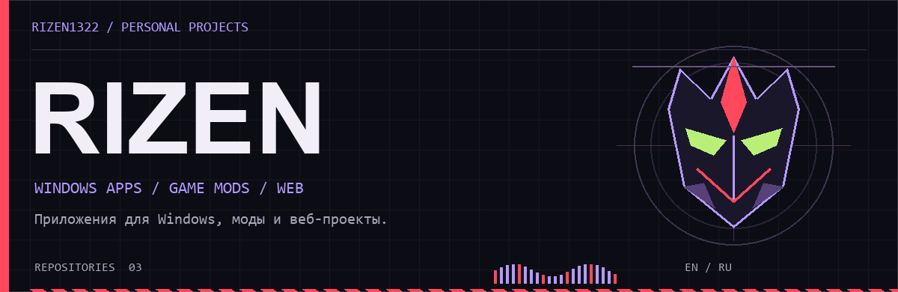
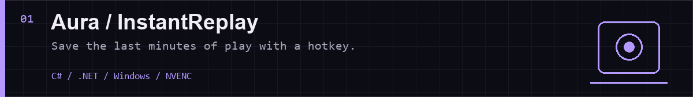
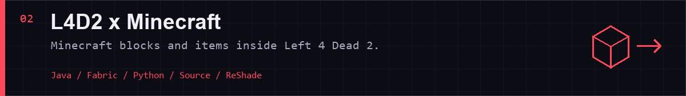
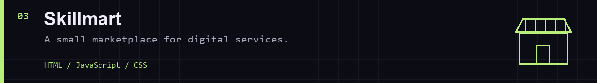

  <picture>
    <source media="(prefers-reduced-motion: reduce)" srcset="assets/header.png">
    
  </picture>

I build Windows apps, experiment with game mods, and make web projects.

Делаю приложения для Windows, экспериментирую с модами для игр и собираю веб-проекты.

[Projects / Проекты](#projects--проекты) · [Activity / Активность](#activity--активность) · [Telegram](https://t.me/fertileperson)

## Projects / Проекты

Background screen recording with a replay buffer, separate game and microphone audio, and clip trimming.

Фоновая запись экрана с буфером повторов, отдельными дорожками игры и микрофона и обрезкой клипов.

[Source / Код](https://github.com/Rizen1322/InstantReplay) · [Download / Скачать](https://github.com/Rizen1322/InstantReplay/releases/latest)

 

Both games run together: Source handles the map and infected; Minecraft supplies blocks, items and mobs. Co-op is experimental.

Обе игры работают вместе: Source отвечает за карту и заражённых, Minecraft даёт блоки, предметы и мобов. Кооператив пока экспериментальный.

[Source / Код](https://github.com/Rizen1322/l4d2-minecraft) · [Install / Установка](https://github.com/Rizen1322/l4d2-minecraft/blob/master/docs/INSTALL.md) · [Releases / Скачать](https://github.com/Rizen1322/l4d2-minecraft/releases)

 

A web project for listing digital services and placing orders, with messaging and reviews.

Веб-проект для публикации цифровых услуг и оформления заказов, с перепиской и отзывами.

[Source / Код](https://github.com/Rizen1322/Skillmart)

## Tools / Технологии

`C#` · `.NET` · `Java` · `Python` · `HTML` · `CSS` · `JavaScript`

Windows capture and encoding · Fabric and Source modding · Web interfaces

Захват и кодирование видео в Windows · Моды для Fabric и Source · Веб-интерфейсы

## Activity / Активность

<picture>
  <source media="(prefers-color-scheme: dark)" srcset="https://raw.githubusercontent.com/Rizen1322/Rizen1322/output/github-contribution-grid-snake-dark.svg">
  <source media="(prefers-color-scheme: light)" srcset="https://raw.githubusercontent.com/Rizen1322/Rizen1322/output/github-contribution-grid-snake.svg">
  
</picture>

 

[Telegram](https://t.me/fertileperson) · [All repositories / Все репозитории](https://github.com/Rizen1322?tab=repositories)
