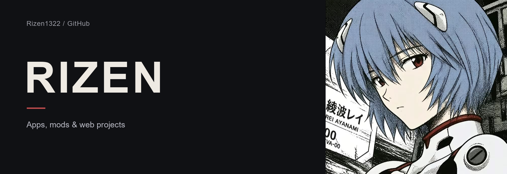
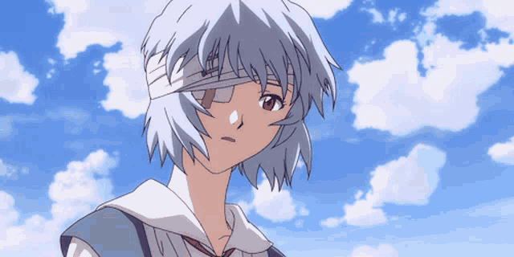
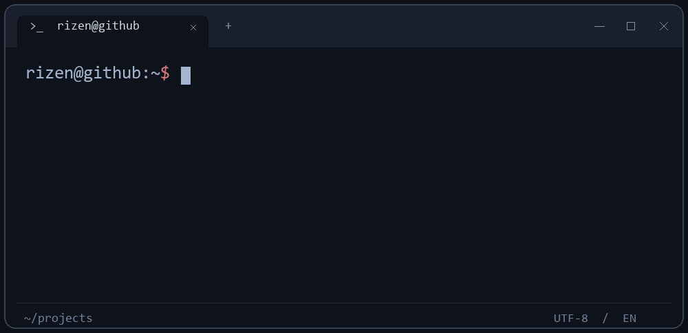
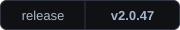
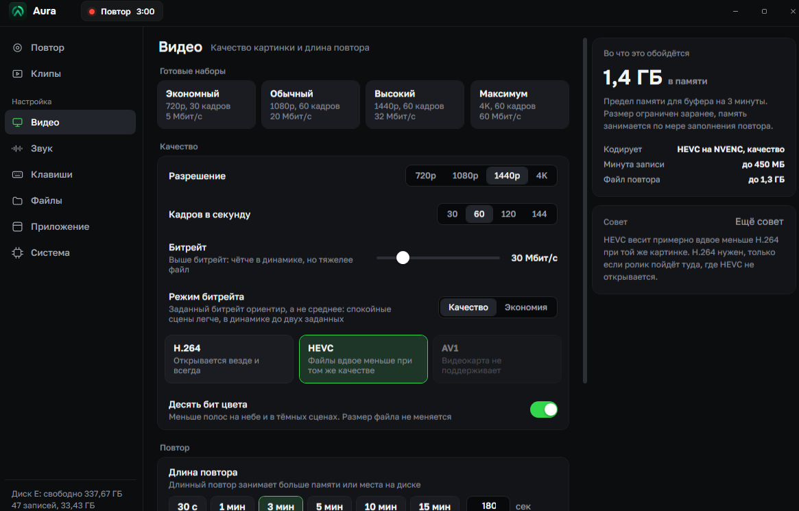
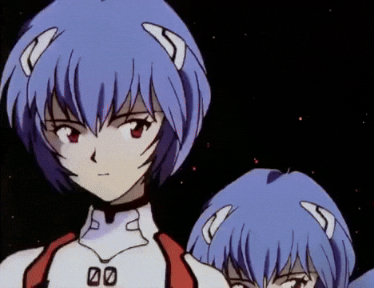
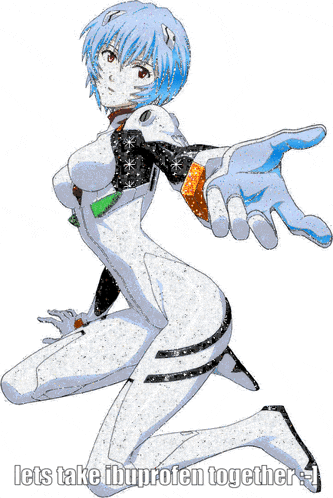
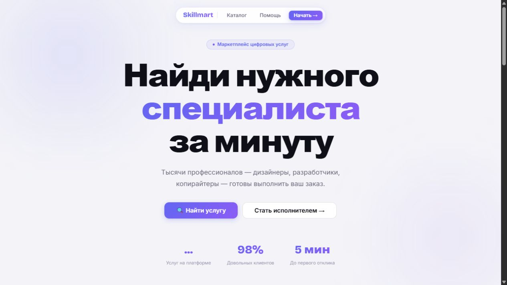
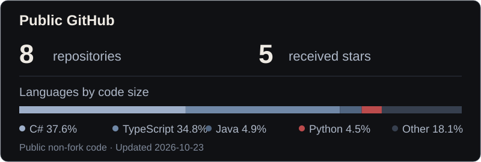

  

<table>
<tr>
<td width="65%" valign="middle">

I build Windows apps, game mods and web projects.

<a href="https://t.me/fertileperson">Telegram</a> · <a href="https://github.com/Rizen1322?tab=repositories">Repositories</a>

По-русски

Делаю приложения для Windows, моды для игр и веб-проекты.

</td>
<td width="35%" align="center" valign="middle">

</td>
</tr>
</table>

<picture>
  <source media="(prefers-reduced-motion: reduce)" srcset="assets/terminal.png">
  
</picture>

По-русски

Делаю то, что хочется. Хочу, чтобы это приносило деньги.

## [Aura](https://github.com/Rizen1322/InstantReplay)

Save the last minutes of play with a hotkey. Replay buffer, separate game and microphone audio, clip trimming.

**[Download for Windows](https://github.com/Rizen1322/InstantReplay/releases/latest)** · [Source](https://github.com/Rizen1322/InstantReplay)

   &nbsp;
   &nbsp;
   &nbsp;
  NVENC

Описание на русском

Сохраняет последние минуты игры по клавише. Буфер повторов, отдельные дорожки игры и микрофона, обрезка клипов.

[Скачать для Windows](https://github.com/Rizen1322/InstantReplay/releases/latest)

## More projects

<table>
<tr>
<td width="50%" valign="top">
<h3><a href="https://github.com/Rizen1322/l4d2-minecraft">L4D2 × Minecraft</a></h3>

Minecraft blocks, items and mobs inside Left 4 Dead 2. Both games run together. Experimental co-op.

 &nbsp; 

Fabric · Source · ReShade

<a href="https://github.com/Rizen1322/l4d2-minecraft">Source</a> · <a href="https://github.com/Rizen1322/l4d2-minecraft/releases">Releases</a>

По-русски

Блоки, предметы и мобы Minecraft внутри Left 4 Dead 2. Обе игры работают вместе. Кооператив экспериментальный.

<a href="https://github.com/Rizen1322/l4d2-minecraft/blob/master/docs/INSTALL.md">Установка</a>

</td>
<td width="50%" valign="top">
<h3><a href="https://github.com/Rizen1322/Skillmart">Skillmart</a></h3>

A small marketplace for digital services, with orders, messaging and reviews.

 &nbsp;  &nbsp; 

<a href="https://github.com/Rizen1322/Skillmart">Source</a>

Preview / Превью

По-русски

Мини-маркетплейс цифровых услуг с заказами, перепиской и отзывами.

</td>
</tr>
</table>

## Activity

 

<picture>
  <source media="(prefers-color-scheme: dark)" srcset="https://raw.githubusercontent.com/Rizen1322/Rizen1322/output/github-contribution-grid-snake-dark.svg">
  <source media="(prefers-color-scheme: light)" srcset="https://raw.githubusercontent.com/Rizen1322/Rizen1322/output/github-contribution-grid-snake.svg">
  
</picture>
